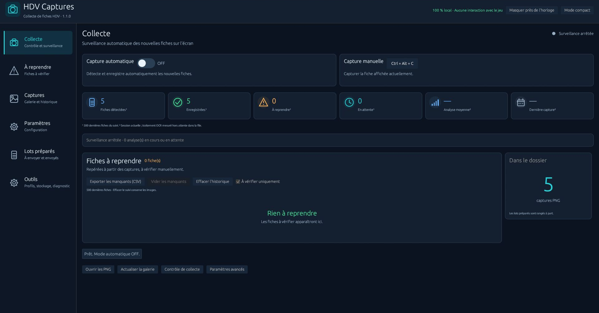
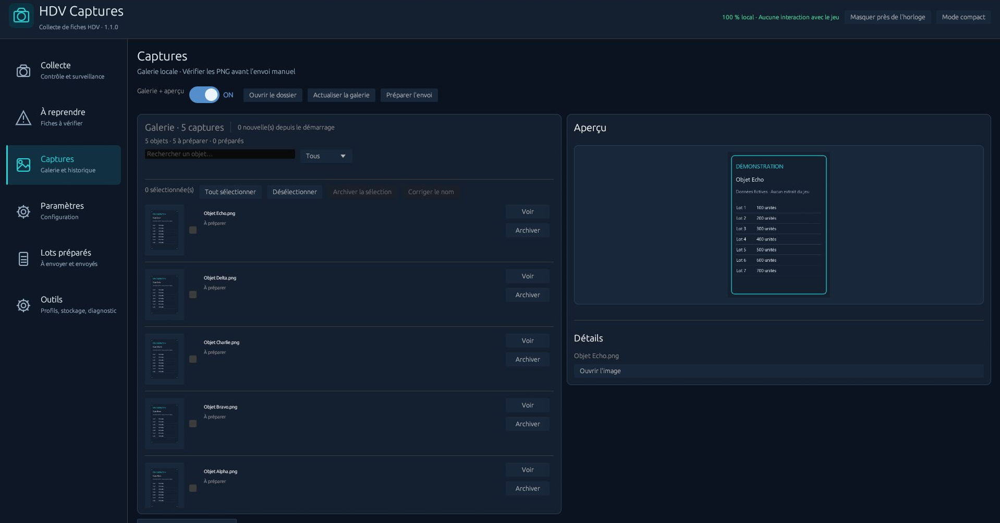
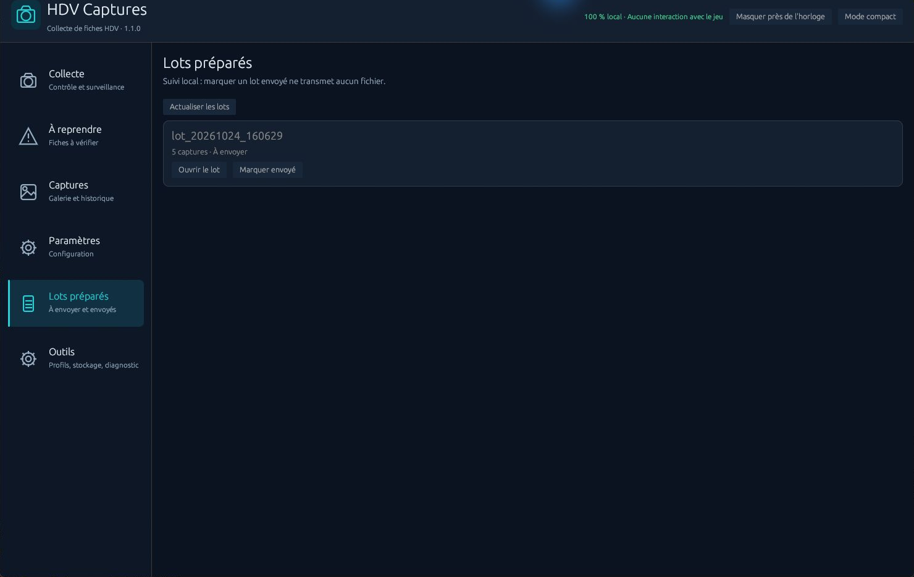
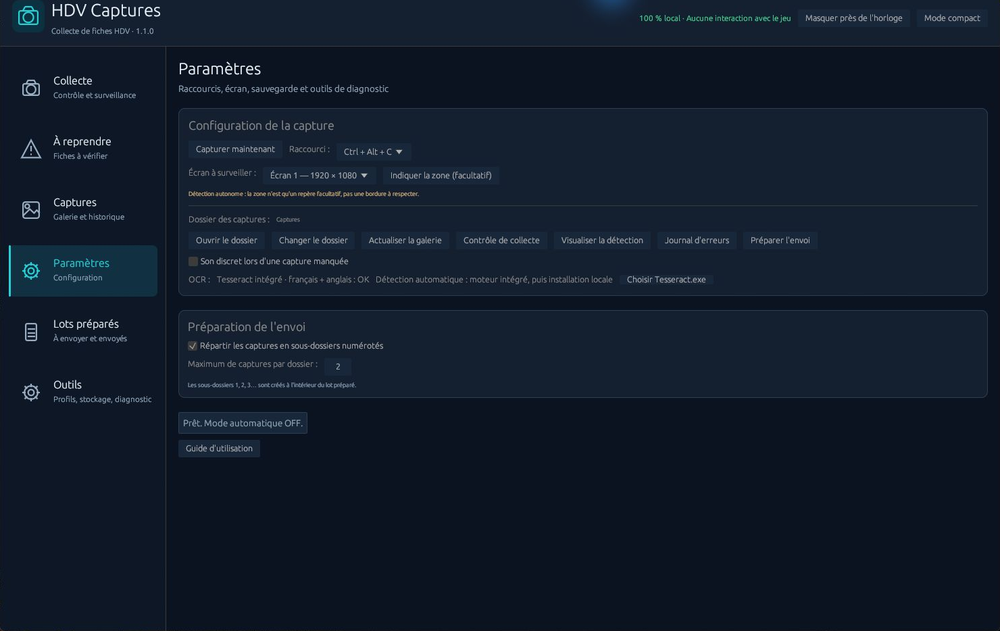

<p align="center"></p>
<h1 align="center">HDV Captures</h1>
<p align="center"><strong>Capturez vos fiches HDV, vérifiez-les et préparez vos lots en quelques clics.</strong></p>
<p align="center">
  <a href="https://github.com/molow159-boop/hdv-captures/releases/latest"></a>
  
  <a href="LICENSE"></a>
</p>
<p align="center">
  <a href="https://github.com/molow159-boop/hdv-captures/releases/latest"><strong>Télécharger pour Windows</strong></a> ·
  <a href="#utiliser">Tuto d’utilisation</a> ·
  <a href="#compiler-sous-windows">Tuto de compilation</a> ·
  <a href="https://github.com/molow159-boop/hdv-captures/issues">Signaler un problème</a>
</p>

**HDV Captures 1.1.0** est une application Windows en Rust pour enregistrer les fiches HDV affichées à l'écran et préparer leur import manuel. Le ZIP Windows inclut le moteur OCR : aucune installation séparée de Tesseract n'est nécessaire.



## Mettre à jour depuis la version 1.0

Ferme complètement l’ancienne application, puis extrais le nouveau ZIP Windows dans un nouveau dossier. Lance **HDV Captures.exe** en gardant le dossier **ocr** à côté. Les réglages, profils et l’historique restent dans **%APPDATA%\HDV Captures** ; le dossier de captures configuré est conservé. Les données de l’édition alternative **HDV Captures Test** restent séparées.

Cette version reprend les outils de gestion de la version alternative et réorganise le code des états, erreurs, écrans et opérations en arrière-plan. Elle conserve le format de l’historique existant. Les dépendances signalées non maintenues n’ont pas été remplacées.

## L’essentiel

| Fonction | Utilisation |
| --- | --- |
| Capture automatique | Enregistrez les nouvelles fiches pendant que vous les parcourez. |
| Capture manuelle | Utilisez le bouton ou un raccourci configurable. |
| Galerie et suivi | Vérifiez les PNG et retrouvez les fiches à reprendre. |
| Préparation de l’envoi | Déplacez les captures dans un nouveau lot, sans reprendre les lots précédents. |
| Sous-dossiers numérotés | Définissez le maximum de captures par dossier. |
| Sélection et noms | Préparez une sélection, corrigez un nom et archivez des images sans écrasement. |
| Lots préparés | Retrouvez les lots et indiquez localement lesquels ont été envoyés. |
| Profils et stockage | Enregistrez vos réglages, mesurez le stockage et examinez les archives à nettoyer. |
| Fenêtre adaptable | Gardez les commandes au premier plan, en mode compact ou près de l’horloge. |

## En images

[](assets/screenshots/captures.png)

*La galerie regroupe la recherche, la sélection multiple, la correction des noms, l’actualisation et la préparation de l’envoi. Les images de démonstration sont fictives ; aucune donnée de jeu personnelle n’est utilisée.*

[](assets/screenshots/lots.png)

*Marquer un lot « Envoyé » enregistre seulement un état local ; aucun fichier n’est transmis automatiquement.*

## Utiliser

1. Télécharge le ZIP **Windows x64** dans la rubrique **Releases** du dépôt, extrais-le entièrement, puis lance `HDV Captures.exe`.
2. Garde le dossier **`ocr`** à côté de l'exécutable : **Tesseract et les langues français (`fra`) et anglais (`eng`) sont inclus**. Aucune installation de Tesseract n'est nécessaire.
3. Choisis ton écran et le dossier de sauvegarde dans **Paramètres**. Affiche une fiche complète dans l'HDV de Dofus 3. Au besoin, utilise le repère de zone et le diagnostic de détection.
4. Dans **Collecte**, active la capture automatique, puis parcours les fiches toi-même. Survole les noms tronqués pour afficher leur infobulle complète. Le bouton manuel et le raccourci affiché permettent une capture à la demande. **Le raccourci initial est Ctrl + Maj + S** ; F8 et F9 sont également proposés dans les paramètres.
5. Vérifie les images dans **Captures**, et les refus dans **À reprendre**. **Voir** affiche l'aperçu ; **Archiver** retire une fiche du suivi après confirmation en conservant son image. L'export CSV et l'effacement du suivi restent disponibles pendant la collecte.
6. Dans **Captures**, coche les images à préparer si tu veux limiter le lot à une sélection ; sans sélection, tout le dossier actif est traité. Clique sur **Préparer l'envoi** : la collecte s’arrête et le logiciel attend la fin des analyses en cours. Les PNG sont déplacés dans **`Envois\lot_<date>`**, retirés de la galerie et de l'aperçu. La liste et le compteur du dossier sont actualisés automatiquement. Importe ensuite les PNG de ce lot manuellement après vérification des noms et des prix. Un nouveau clic ne reprend pas les lots précédents.

Dans **Paramètres → Préparation de l'envoi**, active **Répartir les captures en sous-dossiers numérotés**, puis choisis le maximum par dossier. Exemple : 450 captures avec une limite de 200 donnent trois sous-dossiers : `1` (200), `2` (200) et `3` (50). L'option est désactivée par défaut ; la valeur proposée est 200. Le CSV du lot indique les chemins dans les sous-dossiers.

### Gérer les captures et les lots

- **Corriger le nom** : sélectionne une seule image, saisis le nom puis valide. Le PNG et l’index sont mis à jour ; un objet déjà présent ou préparé n’est pas écrasé. Cette correction ne réentraîne pas l’OCR.
- **Archiver la sélection** : déplace les PNG choisis dans **Corbeille_captures**, où ils restent récupérables. Dans **À reprendre**, archiver une fiche retire seulement son suivi et conserve l’image de contrôle.
- **Lots préparés** : ouvre le dossier d’un lot et indique **Envoyé** une fois ton import manuel terminé. Ce repère est conservé au redémarrage.
- **Outils → Profils** : enregistre puis applique un ensemble de réglages d’écran, de zone, de dossier, de raccourci et de répartition. La collecte est arrêtée lors de l’application d’un profil.
- **Outils → Stockage** : lance l’analyse et relis l’aperçu avant de confirmer un nettoyage définitif. Seules les anciennes images de contrôle, de remplacement et de corbeille sont proposées. Les captures actives et les lots préparés sont exclus.
- **Outils → Diagnostic** : prépare un texte modifiable, relis-le puis enregistre-le localement. Aucune capture, aucun nom d’objet ni chemin personnel n’est ajouté automatiquement.

[](assets/screenshots/parametres.png)

Si Windows indique que `VCRUNTIME140.dll` manque, installe le [redistribuable Visual C++ x64 de Microsoft](https://aka.ms/vc14/vc_redist.x64.exe). Ne télécharge pas de DLL isolée.

La fenêtre reste au premier plan. Le bouton Windows **Réduire** la laisse dans la barre des tâches. **Masquer près de l'horloge** la masque ; clique sur son icône de notification pour la réafficher, ou fais un clic droit pour **Afficher / Quitter**. Windows peut ranger cette icône dans le menu des icônes masquées. La collecte ne restaure pas volontairement la fenêtre ; elle continue si tu l'as laissée active. Fermer avec la croix attend les traitements et les écritures en cours, puis quitte l’application. Une seconde ouverture réaffiche l’instance existante.

La galerie et l'aperçu peuvent être désactivés dans **Captures** pour alléger l'affichage. Le mode compact conserve les commandes essentielles. Les paramètres avancés, l’historique, les diagnostics, le son d’alerte et l’archivage des captures restent accessibles. Les temps d’attente, d’OCR et de sauvegarde sont affichés séparément ; aucun temps inférieur à 0,4 seconde n’est garanti.

Un PNG est conservé par objet : l'automatique évite les doublons ; une nouvelle capture manuelle conserve l'ancienne image dans `Captures_remplacees`. Seules les offres visibles peuvent être capturées. L'OCR peut se tromper : vérifie toujours le résultat.

## Compiler sous Windows

1. Installe [Rust avec rustup](https://rust-lang.org/tools/install/) pour **Windows x64 MSVC**.
2. Installe les [Microsoft C++ Build Tools](https://visualstudio.microsoft.com/visual-cpp-build-tools/) avec **Développement Desktop en C++**, les outils MSVC x64 et un SDK Windows.
3. Ferme et rouvre ton terminal, puis extrais le ZIP de sources disponible dans **Releases** ou via **Code → Download ZIP**.
4. Double-clique sur **COMPILER.bat**. Le script vérifie le formatage, exécute les tests, lance Clippy puis compile la version optimisée. La première compilation nécessite Internet pour télécharger les dépendances de `Cargo.lock`.
5. Le programme se trouve dans **`target\release\hdv-captures.exe`**. Copie à côté le dossier **`ocr`** du ZIP Windows tout compris. Garde ce dossier lorsque tu déplaces ou renommes l'exécutable.

La chaîne vérifiée est fixée dans **rust-toolchain.toml** : **Rust 1.99.1**, avec rustfmt et Clippy. Rustup la télécharge si nécessaire. Lance les commandes depuis le dossier contenant **Cargo.toml**.

Équivalent dans PowerShell, depuis le dossier des sources :

```powershell
rustup component add rustfmt clippy
cargo fmt --check
cargo test --locked
cargo clippy --locked --all-targets -- -D warnings
cargo build --locked --release
```

Tesseract n'est pas nécessaire pour compiler le code Rust ni pour exécuter ses tests. Le script de compilation n'installe aucun outil et ne modifie pas la sécurité Windows.

Pour **recompiler aussi Tesseract**, ajoute le composant **Outils C++ CMake pour Windows** aux Build Tools, puis lance `./Compiler-OCR.ps1` dans PowerShell depuis les sources. Ce script télécharge les sources officielles avec vérification SHA-256 et construit `target\release\ocr`. Les versions, options et langues sont fixées dans le script. Il ne fait aucune installation système. La compilation OCR est facultative si tu reprends le dossier `ocr` du ZIP Windows.

**Place occupée après compilation :** Rust crée automatiquement un dossier `target`, qui peut prendre plusieurs Go avec les dépendances, les tests et les caches. Ce dossier n'est pas fourni dans les sources et n'est pas nécessaire pour utiliser le logiciel. Après avoir copié l'EXE et ses fichiers nécessaires ailleurs, tu peux supprimer `target` ; Rust le recréera à la prochaine compilation.

<details>
<summary><strong>Vérifications et moteur OCR intégré</strong></summary>

## Vérifications complémentaires

Le script **Verifier-Licences.ps1** contrôle la présence des notices pour les dépendances Windows actives. Leur actualisation reste une étape de maintenance manuelle.

Le script facultatif **Verifier-Securite.ps1** utilise **cargo-audit 0.22.2** et RustSec : `cargo install cargo-audit --locked --version 0.22.2`, puis `./Verifier-Securite.ps1`. Il distingue la cible Windows des autres cibles du verrou ; les bibliothèques natives de l’OCR ne sont pas couvertes par ce contrôle.

Pour le test OCR complémentaire, après avoir copié ou compilé le dossier ocr dans **target\release** :

```powershell
$env:HDV_TEST_OCR = (Resolve-Path "target/release/ocr/tesseract.exe").Path
$env:HDV_TEST_FRAME = (Resolve-Path "tests/fixtures/ocr-title.png").Path
cargo test --locked bundled_ocr_reads_a_synthetic_title_at_several_scales -- --ignored
```

Le test utilise une image synthétique aux échelles 80 %, 100 %, 125 % et 150 %. Les essais réalisés et leurs limites sont détaillés dans [VERIFICATIONS.md](VERIFICATIONS.md).

## OCR intégré

Le moteur fourni est **Tesseract 5.5.3**, avec Leptonica 1.87.0, libpng 1.6.58, libtiff 4.7.2, libjpeg-turbo 3.1.3 et zlib 1.3.2. Sa compilation inclut les fonctions utilisées par l'application : lecture des PNG et résultats texte/TSV. Les modèles `tessdata_fast` français et anglais conservent le réglage `fra+eng` de la reconnaissance.

Le moteur intégré utilise ses propres langues. Une mise à jour de Tesseract installé ailleurs sur le PC ne le remplace pas. Dans **Paramètres**, un chemin personnalisé reste prioritaire ; **Détection automatique** revient au moteur fourni. Les licences et les références des sources accompagnent le dossier `ocr`.

</details>

<details>
<summary><strong>Données locales et sécurité</strong></summary>

## Données et sécurité

Les captures vont par défaut dans `%USERPROFILE%\Pictures\HDV Captures`. Les préférences, le suivi SQLite et les journaux restent dans `%APPDATA%\HDV Captures`.

L'application lit les pixels de l'écran et utilise un OCR local. Elle n'envoie pas de clics ni de touches au jeu et n'importe pas automatiquement les captures. Masquer sa fenêtre n'arrête pas la collecte ; arrête-la avant d'afficher du contenu privé dans la zone surveillée.

Ce dépôt contient les sources, les ressources nécessaires, les scripts, les licences, la documentation illustrée et les vérifications Windows. Il ne contient ni historique, ni captures de jeu personnelles, ni configuration utilisateur. Les tests publics utilisent des données synthétiques. Voir [SECURITY.md](SECURITY.md) pour les signalements et la protection des données.

Projet indépendant, sans affiliation à Ankama. Licence [MIT](LICENSE) pour le code du projet ; les dépendances conservent leurs licences, reproduites dans [LICENCES-TIERS.txt](LICENCES-TIERS.txt) et dans le dossier `ocr/licences` du ZIP Windows.

</details>
